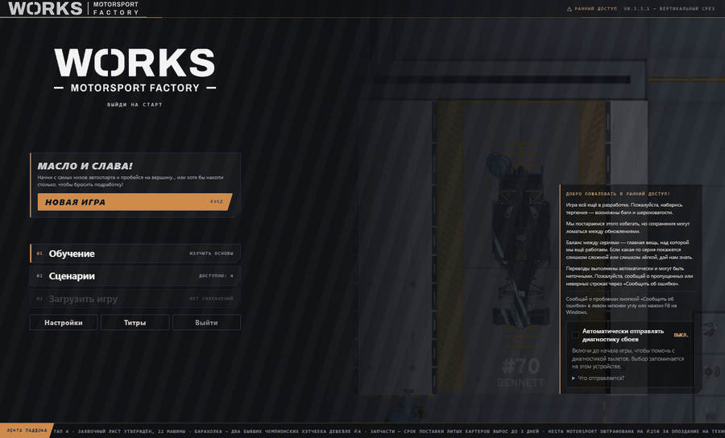
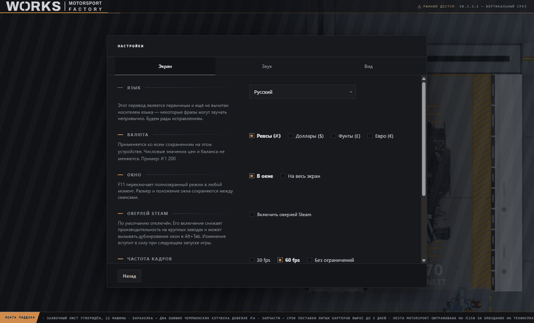
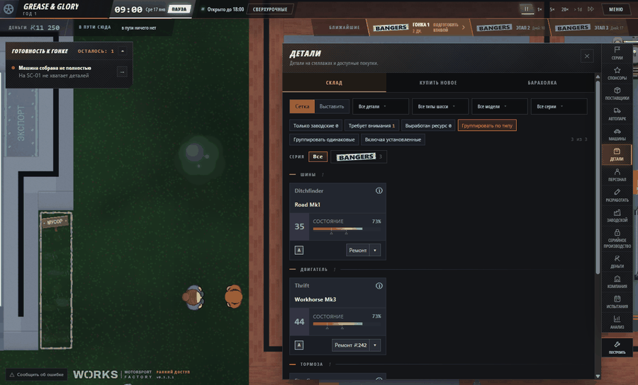

# WORKS: Motorsport Factory — русификатор

[](https://github.com/DomenicoCano/WORKS-Motorsport-Factory-RU/releases/latest/download/WORKS_RU_Installer.exe)

Неофициальный русский перевод для **WORKS: Motorsport Factory**: переведены все 7 608 ключей встроенного словаря (включая корректные русские склонения для числительных через `Intl.PluralRules('ru')`), экран загрузки, надписи на канвасе Phaser и нелокализованные строки интерфейса и симуляции. Кириллица отображается встроенным в игру сжатым шрифтом **Open Sans** в точном стиле оригинала, а русский язык («Русский») добавляется в меню настроек и автоматически включается при первом запуске.

<p align="center">
  
</p>

<table>
  <tr>
    <td></td>
    <td></td>
  </tr>
</table>

## Установка

1. Закройте игру, если она запущена.
2. Скачайте [**WORKS_RU_Installer.exe**](https://github.com/DomenicoCano/WORKS-Motorsport-Factory-RU/releases/latest/download/WORKS_RU_Installer.exe) из раздела Releases.
3. Запустите `WORKS_RU_Installer.exe` — программа сама найдёт папку игры (рядом с собой или в библиотеках Steam), при необходимости укажите её кнопкой **«Обзор...»**.
4. Нажмите **«Установить русификацию»** и дождитесь сообщения о завершении (сборка занимает несколько секунд, так как перепаковывается архив `app.asar`).

### Удаление

Запустите `WORKS_RU_Installer.exe` и нажмите **«Вернуть оригинал»** (восстановит резервные копии `WORKS.exe.orig` и `resources/app.asar.orig`) либо воспользуйтесь проверкой целостности файлов в Steam.

### Автоматическая переустановка после обновлений Steam

Укажите в параметрах запуска игры в Steam:

```text
"C:\путь\к\WORKS_RU_Installer.exe" %command%
```

При каждом запуске через Steam установщик проверит, не сбросились ли файлы игры после обновления; если файлы оригинальные, тихо перенесёт перевод и сразу запустит `WORKS.exe`.

## Что делает установщик

- **Не содержит файлов игры:** читает ваши собственные `WORKS.exe` и `resources/app.asar` и патчит их локально.
- **Резервные копии и атомарная запись:** перед первой установкой сохраняет оригиналы как `WORKS.exe.orig` и `resources/app.asar.orig`, записывает изменения во временные `.tmp`-файлы и заменяет ими рабочие.
- **Совместимость с обновлениями:** находит хешированные бандлы (`releaseGameBridge-*.js`, `main-*.js`) и обфусцированные идентификаторы по структуре кода, а словарь переносит по ключам с проверкой плейсхолдеров (новые строки в будущих патчах останутся на английском и ничего не сломают).
- **Проверка целостности Electron:** пересчитывает поблочные SHA-256 хеши в заголовке `app.asar` и обновляет встроенный SHA-256 заголовка в `WORKS.exe`.
- **Безопасный отказ:** при неожиданной структуре файлов выводит сообщение об ошибке и оставляет файлы игры нетронутыми.

## Что проверено

- Версия игры: **v0.3.3.1** (Early Access — Vertical Slice).
- Валидация словаря ([ru.json](src/data/ru.json)): проверены все **7 608** ключей (плейсхолдеры и маркеры валюты `£` / `\uE000`).
- Скриншоты и консоль (0 ошибок JS и исключений при запуске): главное меню и лента паддока, настройки (язык «Русский» и валюта «Ревсы»), список сценариев (склонения персонала и автопарка), создание основателя («Новая игра»), стартовое окно обучения, игровой цех (разметка на полу `ЭКСПОРТ`/`МУСОР`), верхняя панель, боковое меню, экраны **Детали**, **Деньги**, **Персонал**, **Серии** и **Стройка**.
- Работа самого собранного `WORKS_RU_Installer.exe`: установка на чистую копию, повторная установка из `.orig`, откат к оригиналу, повторный откат, побайтовое совпадение пересобранных `WORKS.exe` и `resources/app.asar` с проверенной сборкой, а также сквозная автопереустановка и запуск в режиме параметров Steam (`WORKS_RU_Installer.exe "<путь>\WORKS.exe"`).
- Сканирование приватности исходников, скриншотов и `WORKS_RU_Installer.exe` (0 совпадений).

## Известные ограничения

- Экраны середины и поздней игры (полный цикл серийного производства и сертификации дорожных авто, редактор тестовой трассы в пит-гараже, итоговое окно гоночного уик-энда) переведены, но не открывались на живых скриншотах — возможны длинные строки или переносы.
- Обратное переключение языка на английский/другие языки в настройках после первого запуска не проверялось на скриншотах.
- Собранный `.exe` не подписан коммерческим сертификатом, поэтому Windows SmartScreen или антивирус могут показать предупреждение при первом запуске (установщик можно собрать самостоятельно из исходников ниже).
- Если найдёте опечатку, невлезший текст или ошибку, откройте [Issue](https://github.com/DomenicoCano/WORKS-Motorsport-Factory-RU/issues).

## Сборка из исходников

Требуется Python 3.10.1+ (или 3.12; на старых версиях PyInstaller в Python 3.10.0 возможен сбой модуля `dis`, проверялось на PyInstaller 6.22.3) и пакет `pyinstaller`:

```bat
src\build.bat
```

Готовый файл появится в `dist\WORKS_RU_Installer.exe`. Исходный словарь перевода находится в [src/data/ru.json](src/data/ru.json).

## Контрольная сумма

SHA-256 для `WORKS_RU_Installer.exe` (релиз `v1.0.0`):

```text
49A901AC8427AD06E35A21669C6DB22369D950AF7E070651B8E1A3478B00E189
```

## Состав репозитория

| Путь | Назначение |
|---|---|
| [src/works_ru_installer.py](src/works_ru_installer.py) | Исходный код установщика (GUI на tkinter, тихий режим Steam, патчер ASAR/EXE) |
| [src/data/ru.json](src/data/ru.json) | Полный словарь перевода (7 608 ключей) |
| [src/data/LICENSE](src/data/LICENSE) | Лицензия CC0 1.0 на словарь перевода |
| [src/build.bat](src/build.bat) | Скрипт сборки `WORKS_RU_Installer.exe` через PyInstaller |
| [docs/](docs/) | Скриншоты переведённой игры |
| [LICENSE](LICENSE) | Лицензия MIT на код установщика |

Собранный `WORKS_RU_Installer.exe` не хранится в дереве репозитория и приложен только к [Releases](https://github.com/DomenicoCano/WORKS-Motorsport-Factory-RU/releases).

## Лицензия

- Код установщика ([src/works_ru_installer.py](src/works_ru_installer.py), [src/build.bat](src/build.bat)) распространяется под лицензией [MIT](LICENSE).
- Словарь перевода ([src/data/ru.json](src/data/ru.json)) передан в общественное достояние по лицензии [CC0 1.0](src/data/LICENSE).

## Важно

Это неофициальный фанатский перевод, не связанный с **River Rock Games**. Установщик предназначен исключительно для легально приобретённых копий игры и не распространяет никаких файлов игры.
